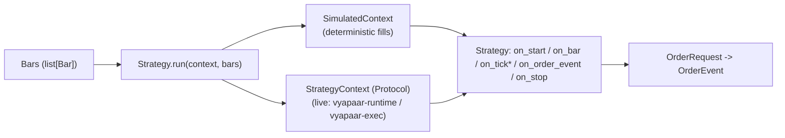

# `vyapaar-strategies` — Architecture & Bounded Context

**Bounded Context**: Production Strategy SDK & Declarative Step Catalog (Tier 6C).

`vyapaar-strategies` is the canonical quantitative strategy repository of the
Vyapaar ecosystem. It provides a pure-Python, Jesse-style strategy authoring SDK
(`on_start` / `on_bar` / `on_tick` / `on_order_event` / `on_stop`), a ported
catalog of StockSharp-inspired strategies, and a declarative manifest layer
(step catalogs + versioned strategy/basket manifests) that names strategies by
`module:Class` for downstream tooling.

## 1. 4-Zone Clean Package

```
vyapaar-strategies/
├── vyapaar_strategies/   # Zone 1: pure-Python SDK + strategies + manifest models
├── catalog/              # Zone 2: declarative step.toml manifests (10 files, 8 families)
├── manifests/            # Zone 2: versioned strategy & basket sidecars (plan 0001)
│   ├── strategies/       #   StrategyManifest TOML sidecars
│   └── baskets/          #   BasketManifest TOML groupings
├── tests/                # Zone 3: unit / lifecycle / manifest-validation tests
├── schema/               # Zone 4: JSON schemas (step, strategy-manifest, basket-manifest)
├── tools/                # Zone 4: manifest linters
└── docs/                 # Zone 4: architecture, code references, gaps, plans
```

### Zone 1 — `vyapaar_strategies/`

Pure Python 3.11+, zero network/filesystem I/O in strategy logic. All financial
math uses `decimal.Decimal` (zero-floats policy).

| Subpackage | Contents |
| :--- | :--- |
| `sdk/` | `Strategy` base class + `IndicatorRegistry`, streaming indicators (`SMA`, `EMA`, `RSI`, `ATR`, `BollingerBands`), `Parameter` descriptor, `Bar`, order domain (`OrderRequest`/`OrderEvent`/`OrderSide`/`OrderType`/`OrderStatus`/`TimeInForce`), `StrategyContext` protocol + `SimulatedContext` harness, `QuoteState` mixin. |
| `strategies/` | Ten ported strategy classes (see `code-strategies.md`). |
| `manifest/` | Pydantic models: `StrategyManifest`, `BasketManifest`, `ParameterSpec`, `InstrumentSelector`, `CapitalAllocation`, `MemberStrategyRef`, `RiskBudget`, `PromotionStatus`/`PromotionRecord` and the `promote()` workflow (plan 0001). |
| `_compat.py` | Optional interop with the `vyapaar` native wheel; `VYAAPAAR_AVAILABLE` flag, `decimal.Decimal` fallback. |

### Zone 2 — `catalog/` & `manifests/`

- `catalog/*.toml` — declarative step manifests. Ten files across eight
  families: `arbitrage/`, `execution/`, `market_making/`, `mean_reversion/`,
  `options/`, `portfolio/`, `size/`, `trend/`. Each names `name`, `title`,
  `family`, `version`, `strategy = module:Class`, and `[params.*]` defaults with
  optional `min`/`max`/`step`.
- `manifests/strategies/*.toml` — `StrategyManifest` sidecars (`turtle_breakout`,
  `twap_slicer`) with parameter snapshots, target instruments, and a capital
  allocation.
- `manifests/baskets/*.toml` — `BasketManifest` groupings
  (`turtle_twap_basket`) under a combined capital and Phase-1 risk budget.

### Zone 3 — `tests/`

Tests live in `tests/` parallel to the package (never inlined into
`vyapaar_strategies/`). Suites: `tests/sdk/` (indicators, parameters, strategy
lifecycle), `tests/strategies/` (one file per strategy), `tests/manifests/`
(manifest models, promotion, schema conformance), `tests/catalog/` (step.toml
schema + strategy-class parity), `tests/test_init.py` (package export).

### Zone 4 — `schema/` & `tools/`

- `schema/step.schema.json`, `schema/strategy-manifest.schema.json`,
  `schema/basket-manifest.schema.json` — JSON Schema (draft-07) mirrors of the
  catalog and manifest TOML shapes.
- `tools/validate_catalog.py` — schema + required-key + strategy
  import/instantiate checks over every `catalog/**/*.toml`.
- `tools/validate_manifests.py` — schema + pydantic model + parameter
  cross-check + instantiate for strategy manifests; schema + model + member-ref
  resolution for basket manifests.

## 2. Event Loop & Research–Live Parity Goal

Strategies never talk to a broker or feed directly; they run inside an
execution `StrategyContext` injected via `Strategy.run(context, bars)`.



- `SimulatedContext` is the only concrete context shipped in this repo:
  market orders fill immediately at the current bar close; resting limit orders
  fill at their limit price once crossed and are re-checked per bar.
- The `StrategyContext` protocol (`submit`, `current_price`, `position`) is the
  seam for a future live/feed-backed context. No such context exists in-repo
  today — see [gap 0002](../gaps/0002-no-live-strategy-context.md).
- `on_tick` is declared but never dispatched by either run path (bars only) —
  see [gap 0001](../gaps/0001-on-tick-not-dispatched.md).

## 3. Declarative Layers & Cross-Repo Consumption

- The `catalog/` step manifests are **schema-validated in-repo but not
  executed here**: `tools/validate_catalog.py` and `tests/catalog/` prove schema
  conformance and that every `module:Class` reference imports and instantiates.
  Executing a step (backtest/live) is owned by `vyapaar-runtime` /
  `vyapaar-exec`; visual-studio chaining is owned by `vyapaar-ui`. See
  [gap 0003](../gaps/0003-catalog-declarative-only.md).
- `BasketManifest` consumption (a multi-strategy run loop under a combined
  capital/risk budget) is a `vyapaar-runtime-backtest` concern, cross-referenced
  only — see [gap 0004](../gaps/0004-no-basket-run-loop.md).

## 4. Zero-Floats / Decimal Policy

- Prices, quantities, basis, allocations, weights, and indicator outputs are
  `decimal.Decimal` throughout. Integer parameters are converted exactly
  (`Decimal(str(value))`); no `float` appears in financial paths.
- `BollingerBands._stddev`, `RiskParity._volatility` use `Decimal.sqrt`
  (rounded at the active decimal context precision, as the tests note).
- `Parameter` values are validated against `min`/`max` and aligned to `step`
  from `min` using exact `Decimal` modular arithmetic.
